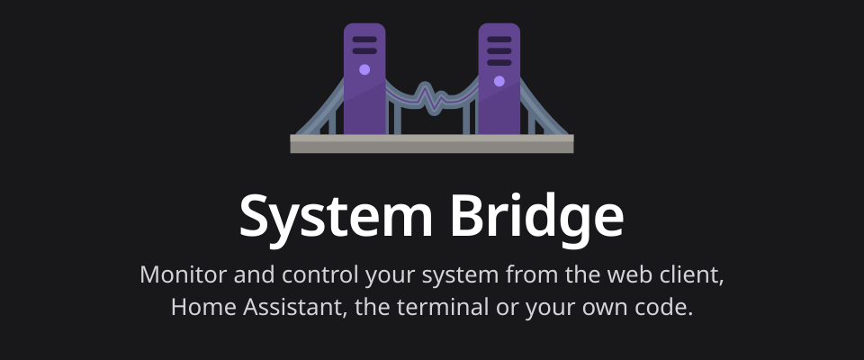

# System Bridge Dashboard

A Home Assistant dashboard for [System Bridge](https://system-bridge.timmo.dev).
It lays out a machine's sensors with a view for each page, such as CPU, Disks
and GPUs, built from the System Bridge integration's entities.

Requires Home Assistant 2026.10 or later.

<!-- ha-marketplace:exclude-start -->

## Installation

1. Open the repository in the Marketplace with the button above.
2. Select **Install**. The dashboard resource is added for you.
3. Reload your browser.

<!-- ha-marketplace:exclude-end -->

## Add the dashboard

1. Use the button above, or go to **Settings > Dashboards**.
2. Select **Add dashboard** and choose **System Bridge**.
3. With more than one System Bridge device, choose one in **Edit dashboard**.

See the [dashboard documentation](https://system-bridge.timmo.dev/using/home-assistant#dashboard)
for its options, manual installation and adding its sections to other
dashboards.

Each release's `system-bridge-dashboard.js` has a build provenance attestation
from the System Bridge repository. Check a download with
`gh attestation verify system-bridge-dashboard.js -R timmo001/system-bridge`.

This repository is generated from
[timmo001/system-bridge](https://github.com/timmo001/system-bridge/tree/dev/client/home-assistant/frontend).
Open issues and pull requests there.
