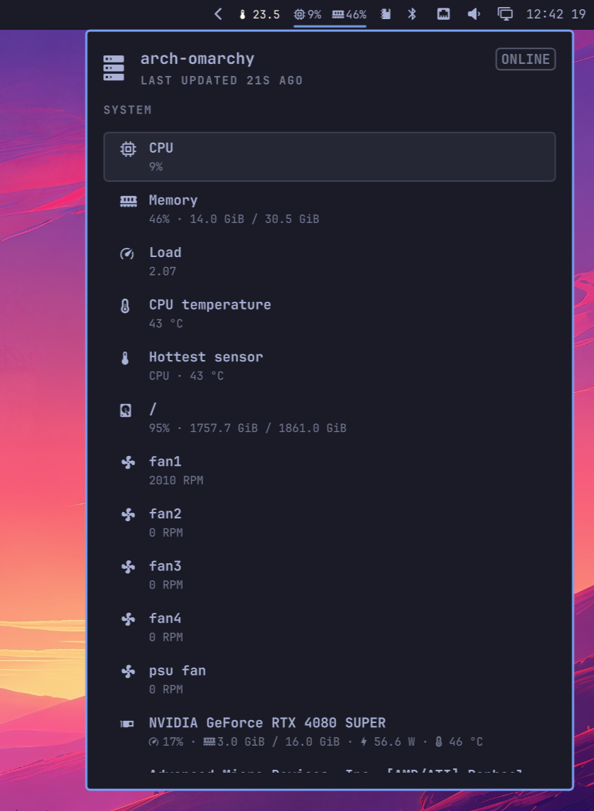

# System Bridge for Omarchy

An Omarchy bar widget and panel for System Bridge. It shows CPU and memory
usage in the bar. The panel has an overview of the system and a view for every
module the web client has a page for, with media and Discord controls.



## Requirements

- Omarchy Quattro
- [System Bridge installed](https://system-bridge.timmo.dev/install/) with the
  `system-bridge` executable available on `PATH`, in a version with the
  `client open --path`, `client media` and `client discord` commands
- A running local System Bridge service
- `zenity` for the quit confirmation prompt

## Install

Review the repository, then add the plugin:

```bash
omarchy plugin add https://github.com/timmo001/omarchy-system-bridge.git
```

Accept the prompt to enable the plugin during installation.

For an unattended install from a repository you already trust:

```bash
omarchy plugin add \
  https://github.com/timmo001/omarchy-system-bridge.git \
  --enable --yes
```

## Use

Select the widget to open its panel. It starts on the overview: CPU, memory,
GPU, CPU temperature and battery meters, storage, network traffic, what's
playing, and a row for each module.

Select a reading or a module to open its view. Each view has the module's
readings, and links to the matching part of the web client for anything you
set up there, such as commands, disk mounts, media directories or Discord. The
media view has previous, play or pause, and next; the Discord view has mute,
deafen and leave call.

Type to filter the rows, use Up and Down to move through them, and press Enter
to select one. Backspace or the back button returns to the overview, and Escape
clears the filter or closes the panel.

The header has two buttons: one opens the current view in the web client, and
the other asks for confirmation before quitting System Bridge. While
disconnected, the quit button starts System Bridge with
`system-bridge backend`.

The plugin has no System Bridge settings of its own. Change those in the web
client.

The plugin exposes the `timmo.system-bridge` shell IPC target with `open`,
`close`, `show`, `hide`, and `toggle` methods:

```bash
omarchy-shell shell toggle timmo.system-bridge
```

## Settings

- `primaryOnly`: show the widget only on the selected output
- `primaryOutput`: optional output name used when `primaryOnly` is enabled;
  the first available output is used when this is empty or unavailable

## Update

Review and apply the next fast-forward update:

```bash
omarchy plugin update timmo.system-bridge
```

## Remove

```bash
omarchy plugin remove timmo.system-bridge
```

## Validate from source

```bash
omarchy plugin validate .
```

## Security

This plugin runs unsandboxed inside `omarchy-shell` when enabled. Review its
source before installing it.

The plugin starts one long-running local data process, which watches every
System Bridge module:

```text
system-bridge client data watch --module system --module processes ...
```

It reads System Bridge settings and its local authentication token through the
System Bridge client. Its buttons run `system-bridge client` commands to open
the web client, control media and Discord, and quit or start System Bridge.
